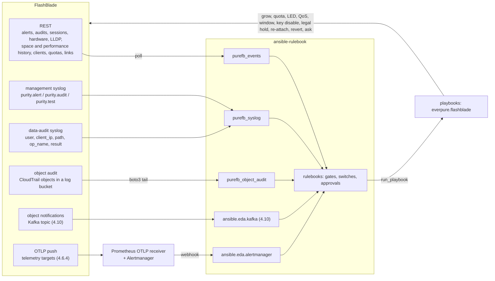

# flashblade-eda

Event-Driven Ansible for Everpure FlashBlade.

A FlashArray tells you what happened to a volume. A FlashBlade tells you
who did it, from where, to which file or object, and can push that itself.
This project turns a FlashBlade's alert log, audit and session logs,
hardware and LLDP view, space and performance history, per-client
performance and quota state into `ansible-rulebook` events and acts on
them through the `everpure.flashblade` collection. No Pure1, no Fusion and
no external monitoring stack are required. It is the sibling of
[flasharray-eda](https://github.com/sdodsley/flasharray-eda) and reuses
its plugin skeleton, rulebook conventions, approval paths and notify
playbook.

Status: a prototype, not a supported product, at version 0.1. Everything
in the tree is built, unit-tested and verified on a FlashBlade//S200
running Purity//FB 4.6.4 and 4.8.8 (REST 2.21 and 2.30), its Purity//FB
4.5.6 replication peer and a containerized Ansible Automation Platform
2.7 with the automation orchestrator beside it; the lab exit tests, their
results and
what the lab cannot show are in
[docs/VERIFICATION.md](docs/VERIFICATION.md).

The transports the design uses. Four are built: REST pull, management
syslog, the object-audit tail and OTLP push into a Prometheus receiver
with Alertmanager; Kafka waits for Purity//FB 4.10 (the roadmap at the end
of this page):



## Quick start

Requirements: Python 3.9+ and Java 17+ (for ansible-rulebook);
ansible-rulebook 1.3.x and ansible-core 2.17 (the tested versions;
`requirements.txt` holds the minimums); `everpure.flashblade` >= 1.29.0 and
`ansible.eda` >= 2.13.0 (`requirements.yml`); py-pure-client >= 1.98.0;
boto3 >= 1.26 for the object-audit source and the S3 task file; Prometheus
3.x with its OTLP receiver and Alertmanager only for the telemetry path
([prometheus/README.md](prometheus/README.md)).
Written against Purity//FB 4.6.4 and 4.8.8 (REST 2.21 and 2.30); the
maintenance-window gate
needs 4.5.2 (REST 2.16) and reads false on anything older; object audit
needs 4.6.3 (REST 2.20); telemetry targets and metric policies are served
on 2.21 and the modules reach them over REST because the SDK names them
from FB_2_29 only.

```
python3 -m venv venv && . venv/bin/activate
make deps                                   # pip install -r requirements.txt; ansible-galaxy collection install -r requirements.yml; make collection
cp env.example ~/.flashblade-eda.env        # URLs and tokens for the arrays, the FB_A_S3_* keys of the object side, APPROVAL_TOKEN, GIT_WEBHOOK_SECRET; optional AO_CLIENT_*, SLACK_WEBHOOK_URL; chmod 600
cp vars/example.yml vars/local-lab.yml      # edit: arrays, absolute paths (alert_log, request_dir, baseline_dir), baselines, thresholds, switches
cp inventory/example.yml inventory/local-lab.yml
./run.sh extensions/eda/rulebooks/alerts.yml -v
```

The repository is the collection `sdodsley.flashblade_eda` (`galaxy.yml` at
the root): the rulebooks name their event sources by FQCN,
`sdodsley.flashblade_eda.purefb_events`,
`sdodsley.flashblade_eda.purefb_syslog` and
`sdodsley.flashblade_eda.purefb_object_audit`, and the event filter every
source runs, `sdodsley.flashblade_eda.jinja_safe`, and ansible-rulebook
resolves them from an installed collection; the eleven modules under
`plugins/modules/` resolve the same way (`sdodsley.flashblade_eda.purefb_log_target`
and its siblings). `make collection` (which `make deps` runs
last) builds the tarball into `build/` and installs it under
`./collections`; [docs/PACKAGING.md](docs/PACKAGING.md) has the details.

`run.sh` sources `env.sh`, which loads `~/.flashblade-eda.env` (override
with `FBEDA_ENV`), activates `./venv` (`FBEDA_VENV`) or else expects
`ansible-rulebook` on the PATH and says so, puts `./collections` (when that
directory exists) and `~/.ansible/collections` on
`ANSIBLE_COLLECTIONS_PATH`, which is where the FQCN sources resolve from,
and defaults `FBEDA_VARS` to `vars/local-lab.yml` and `FBEDA_INVENTORY` to
`inventory/local-lab.yml`. It then starts the rulebook and hands
`APPROVAL_TOKEN` and `GIT_WEBHOOK_SECRET` to ansible-rulebook with
`--env-vars` when they are set in the environment; that is how the webhook
rulesets read them (`{{ APPROVAL_TOKEN }}` in a rulebook is an environment
variable, not a vars-file key).

Four things to get right on the first run:

- **Arrays.** The example vars and inventory name two arrays, `fb-a` and
  `fb-b`. Either fill in both the `FB_A_*` and `FB_B_*` pairs in the env
  file, or remove `fb-b` from `purefb_arrays` and from the inventory. The
  source plugin refuses to start when a listed array's environment
  variables are empty.
- **Paths.** `alert_log` and `request_dir` default under `/var`
  (`/var/log/flashblade-eda/alerts.log`, `/var/lib/flashblade-eda/requests`),
  which needs root or a directory created and chowned beforehand; for a
  local run point them at a directory the rulebook user can write.
  `baseline_dir` (default `/opt/flashblade-eda-baseline`) is a separate
  checkout of the baseline repository, not this tree.
- **Credentials.** Tokens and URLs reach the plugin through
  `api_token_env` / `fb_url_env` and the playbooks through the inventory's
  `lookup('env', ...)` into `fb_url` and `api_token`, so no vars file holds
  a secret. Give the polling token a `readonly` role; the plugin only
  issues GETs. The remediation playbooks use the inventory credential,
  which should be a dedicated service account named in `automation_users`.
- **Object store.** The object side needs an account, three buckets and
  three users on the array ([docs/HARDWARE_NOTES.md](docs/HARDWARE_NOTES.md),
  "Object audit") and their keys in the env file: `FB_A_S3_ENDPOINT` (the
  data VIP), `FB_A_S3_ACCESS_KEY` / `FB_A_S3_SECRET_KEY` (the read-only
  tail user) and `FB_A_S3_STATE_ACCESS_KEY` / `FB_A_S3_STATE_SECRET_KEY`
  (the state user that writes the cursor copy, the request objects and the
  receipts). `object_audit_arrays` and `object_store` in the vars file name
  those variables; nothing reads a key from a vars file or a command line.

## What it does

| Rulebook | Source | Fires on | Action |
| --- | --- | --- | --- |
| `alerts.yml` | alerts | alert opened, severity raised, closed | routes through the alert-code runbook map (`alert_runbooks`: notify, ticket, or per-code tasks under `playbooks/runbooks/<code>.yml`) with the array's own action text and KB link, then sets the alert's `flagged` bit as the handled marker; already-open alerts arrive as `initial` and are logged |
| `change_control.yml` | audits, webhook | a governed command (`governed_commands`) by anyone but the automation account; a destructive subcommand by a human; a signed git push | NTP and DNS reconciled from the baseline files and the user reported; everything else and every human destroy notified with user, address, interface, command, subcommand and arguments; the automation's own change logged |
| `config_drift.yml` | config | NTP, DNS, directory service, eradication delay and manual eradication, admin lockout and password settings, SSO, Active Directory join, missing data-audit syslog target vs the baseline keys | NTP and DNS reapplied (`purefb_ntp`, `purefb_dns`); the rest notify |
| `health.yml` | health | hardware component whose status is an issue; LAG degraded (status, or `lag_speed` under the sum of its ports); blade or drive issues; component recovered; remote assist, maintenance window | hardware issue outside a window: identify LED (`purefb_hardware`) with the component's LLDP neighbour (switch, port) in the record; inside a window: logged; LAG degraded: critical notify naming the switch ports; blade and drive issues, recovery: notify |
| `capacity.yml` | telemetry, webhook | used % over `capacity_risk_pct`; days-to-full from the array's 7-day space history under `capacity_days_to_full_warning`; a file system at `fs_quota_grow_pct` of a hard quota; an approval (bearer token) | approval request listing pending-eradication file systems, buckets and snapshots and the top growers; reclaim only when approved; `grow_fs.yml` grows a hard-limited file system by `fs_grow_step_pct` up to `fs_grow_max_bytes` behind `fs_auto_grow`, and asks above the cap; with `s3_requests_enabled` both requests are also written to `<log_bucket>/requests/<id>.json` for the S3 approval inbox of `object_audit.yml` |
| `object_audit.yml` | purefb_object_audit, audits | a canary object read by a key not in `canary_readers`; a honey-suffixed key touched; a landing marker (`_SUCCESS`, `manifest.json`) written under a landing prefix; an object written under an evidence prefix; an approval object written under `approvals/` in the log bucket; an access-denied storm, an error storm or a mass delete in one log object; the log bucket at `log_bucket_quota_warn_pct` of its quota; no log object for `stale_rotations` rotations; a bucket without an enabled audit policy, a disabled policy or a member bucket without a filter; a human `purepolicy`, `purelog` or `purebucket` change to the audit configuration (audits signal) | `canary.yml` disables the key (`PATCH /object-store-access-keys enabled false`) behind `canary_auto_disable_key`, else notify critical; honey and mass delete notify critical; `landing.yml` records the dataset and, behind `landing_enabled`, runs `landing_command` with the dataset, writer and source address in its environment; `lock_on_arrival.yml` puts a legal hold on the object behind `legal_hold_on_arrival` (off by default); `s3_approval.yml` runs the proposed action of a request whose approval a key in `approval_keys` wrote and leaves a receipt; `s3_anomaly.yml` notifies critical and disables the top key behind `anomaly_auto_disable_key`; `auditor_guard.yml` raises the log bucket quota by `log_bucket_quota_step_pct` within `log_bucket_quota_max_bytes` (0 = notify only) and re-attaches the policy, log target and filters from `audit_baseline` behind `audit_auto_reattach`, else records what it would do, naming the human when there is one; a stale log pages when `audit_log_expected_continuous` |
| `posture.yml` | posture | a public bucket; a world-open NFS export rule (client `*`, `rw`); an access key older than `key_max_age_days`; a certificate within `cert_warn_days` of expiry; a bucket without audit coverage; an SMB share policy granting Everyone full control | `posture_revert.yml` blocks public access (`purefb_bucket block_public_access`) behind `posture_auto_revert`, else notify warning; `renew_certificate.yml` renews a certificate the array issued to itself for `certs_renew_days` with `purefb_certs` behind `certs_auto_renew` (a CA-issued or external one is recorded as needing a human); the rest notify, once a day per array |
| `quota_user.yml` | alerts (1106, 1107) | a user or group quota alert opened or updated | `user_quota.yml` reads the quota and usage for that file system and user, notifies, and behind `auto_raise_user_quota` raises it by `user_quota_step_pct` up to `user_quota_max_bytes` (`purefb_userquota`, `purefb_groupquota`) |
| `client.yml` | telemetry | array write latency at `baseline_latency_ratio` times the same half hour last week and one NFS or SMB client holding `client_min_share_pct` of ops for `client_consecutive_polls`; a file system holding `qos_cap_min_share_pct` in the same state; a capped file system normal for `qos_lift_normal_polls` | the client's IP mapped to an inventory host and read-only diagnostics run there behind `client_actions_enabled`; a QoS policy `eda-cap-<fs>` created and assigned behind `qos_auto_cap`; the cap lifted |
| `contain.yml` | telemetry, webhook | one client holding `contain_min_share_pct` of the array's ops for `contain_consecutive_polls` polls while array write latency is at `baseline_latency_ratio` times last week's (`baseline_known`); a file system holding that share for that long with no cap on it; a tarpitted file system normal for `contain_release_normal_polls`; `{array, action, client, file_system}` under the bearer token on `locks_port` | `quarantine_client.yml` downgrades the client to read-only behind `ir_auto_contain` (its legacy `nfs.rules` entry rewritten from `rw` to `ro`, or an export-policy rule `client <ip> permission ro` inserted before the policy's first rule), else notify critical; a client in `contain_exclude_clients` or one of the array's own addresses is refused and `contain_exclude_file_systems` are skipped; `tarpit.yml` creates the QoS policy `eda-tarpit` at `tarpit_ops_per_sec` and assigns it behind `ir_auto_tarpit` (a file system already carrying a policy is recorded, not replaced), and lifts it when the file system is calm; the webhook quarantines or releases a client, breaks a dead client's sessions and locks (`release_locks.yml` through `purefb_fs_session`, the approver named in the record) and applies or lifts the tarpit by hand |
| `replication.yml` | replication | an array connection whose status is not `connected`, and its return; a replica link paused; a link whose status is outside `replication_ok_statuses` or whose lag is over `replication_lag_warn_s`, escalating after `replication_escalate_polls` polls; a link recovered; the per-poll summary | notify at critical for a connection down (once an hour per array and remote), at warning for an unhealthy or lagging link (1-hour throttle per link), critical once escalated (6-hour throttle); `replication_resume.yml` resumes a paused bucket link (`purefb_bucket_replica paused: false`, the link's target and credential read first) behind `replication_auto_resume`, else notify; a connection back and a link recovered are logged; the summary is logged at debug |
| `maintenance.yml` | webhook, audits | `{array, action: open, extend or close, hours}` under the bearer token; a window a human opened (`puremaintenance` in the audit stream) | `maintenance_window.yml` posts, re-posts or deletes the array's one window; the human window is logged |
| `sessions.yml` | sessions, alerts (1140, 1123) | a login from outside `admin_cidrs`; repeated failed attempts; the superuser-password-login and default-password alerts | notify |
| `syslog.yml` | purefb_syslog | `purity.alert`, `purity.audit` and `purity.test` lines pushed by the array; data-audit JSON records when a `data-audit` syslog target points here | fast notification seconds after the fact (an alert at its severity while open, a notice at info when it closes); the REST plugin owns every action |
| `alertmanager.yml` | ansible.eda.alertmanager | alerts from `prometheus/flashblade.rules.yml` on the array's OTLP push, by `alertname`: `FlashBladeTelemetrySilent`, `FlashBladeHealthNotOk`, `FlashBladeCapacityHigh`, `FlashBladeLatencyHigh`, `FlashBladeConnectorErrors`, `FlashBladeReplicationStalled`, any other firing alert, every resolved one | `telemetry_check.yml` tells a pipeline fault from a dead array or a dead receiver (the array's own `GET /telemetry-targets/test`, the management VIP, `prometheus_url`) and records its `verdict`; health not ok notifies critical; capacity high raises a capacity request (`capacity_request.yml`, mirrored to S3 when `s3_requests_enabled`); latency, connector errors and a stalled replication notify warning; other firing alerts notify at their severity label (default warning); resolved alerts notify info |
| `housekeeping.yml` | ansible.eda.tick | every `housekeeping_interval` seconds (default 3600) | `selftest.yml` checks REST, the state bucket, the audit policy, the telemetry target and Prometheus (`selftest_checks`; one record, critical when a check failed); `showback.yml` writes the day's ledger `<showback_prefix><date>/<array>.json` (file systems, buckets, accounts, totals) to `showback_bucket` once a day; `dr_drill.yml` runs the drills listed in `dr_drills` at `dr_drill_hour` UTC, once a day per file system (promote the replica on the peer, wait, read it, demote; a critical record on any failure, the demote in an always block) |

The gates are what each event allows. `maintenance_active` (one cached
`/maintenance-windows` read per array; false where the endpoint is absent)
travels on alert, audit, session, health, hardware, config, posture and
replication events (the summary, each replica link and each connection
event) and holds back the alert runbooks, the reconcile and the identify
LED; the telemetry events carry no flag, so the file system grow, the client
diagnostics, the QoS cap, the quarantine and the tarpit run inside a window too, and the array itself
keeps routing the codes it exempts from a window (1101, 1106, 1107 among
them), so the quota rules fire inside one. `automation_users` (plus the
`pure/py-pure-client` user agent, reported as `automation_agent`) keeps
the audit-driven rules from reacting to the automation's own changes; on
S3 events `by_automation` does the same for records written by
`automation_keys` (the tail and state keys by default). Twelve per-site
switches fall back to notify: `fs_auto_grow`, `auto_raise_user_quota`,
`client_actions_enabled`, `qos_auto_cap`, `canary_auto_disable_key`,
`anomaly_auto_disable_key`, `audit_auto_reattach`, `posture_auto_revert`,
`ir_auto_contain`, `ir_auto_tarpit`, `replication_auto_resume` and
`certs_auto_renew`; `legal_hold_on_arrival` (a hold only adds protection
and the array audits it back) and `landing_enabled` (the ingest command;
an arrival is logged otherwise) are off until the site turns them on; the
reapply, the reconcile and the identify LED have none; breaking a client's locks and
sessions has no switch at all, only the approval webhook on `locks_port`;
`orchestrator_enabled` moves the
capacity decision into the automation orchestrator and
`s3_requests_enabled` adds the S3 approval inbox to the request paths.
Every record a playbook writes to the alert log carries
`time`, `kind`, `severity` and `array`, and every notification also
reaches Slack when a webhook is configured ("Notifications" below).

## Layout

```
galaxy.yml, meta/runtime.yml           the repository root is the collection sdodsley.flashblade_eda (docs/PACKAGING.md)
extensions/eda/plugins/event_source/   purefb_events.py (REST pull, eight signals), purefb_syslog.py (push),
                                       purefb_object_audit.py (boto3 tail of the object-audit log bucket)
extensions/eda/plugins/event_filter/   jinja_safe.py (on every source: keeps template delimiters in event strings inert,
                                       so a playbook renders event text as text)
extensions/eda/rulebooks/              one rulebook per domain (table above), sources named by FQCN, every source
                                       filtered by jinja_safe
extensions/eda/rulebooks/platform/     the platform variants (run_job_template, no webhook or tick rulesets), generated by
                                       tools/platform_rulebooks.py and run as activations on the platform
plugins/modules/                       purefb_log_target, purefb_audit_policy, purefb_bucket_audit_filter (the object-audit
                                       configuration), purefb_telemetry_target, purefb_telemetry_policy, purefb_maintenance,
                                       purefb_qos, purefb_fs_session, purefb_legal_hold, purefb_alert_flag, purefb_eradication:
                                       what the collection has no module for yet
playbooks/                             notify, alert_runbook (+ runbooks/<code>.yml), flag_alert, identify_led, reconcile,
                                       remediate_ntp, remediate_dns, capacity_request/reclaim, orchestrator_post, grow_fs,
                                       user_quota, client_diagnose, qos_cap, qos_lift, maintenance_window,
                                       canary, s3_anomaly, landing, lock_on_arrival, s3_approval, auditor_guard, posture_revert,
                                       telemetry_setup, telemetry_check, quarantine_client, tarpit, release_locks,
                                       replication_resume, dr_drill (+ tasks/dr_drill_one.yml, one drill), showback, selftest,
                                       renew_certificate,
                                       tasks/resolve_array.yml (the array's URL and token), tasks/fb_rest.yml (one raw
                                       REST call for the endpoints the collection has no module for), tasks/s3_object.yml
                                       (one S3 get, head, put or legal hold with the keys read from the environment)
prometheus/                            flashblade.rules.yml (generated from the lab array's twelve metric policies),
                                       prometheus.example.yml (the OTLP receiver, no scrape jobs), alertmanager.example.yml
                                       (routing to the EDA listener), README.md (how the array pushes, how to run the
                                       receiver and Alertmanager, the ssh tunnel, the generator, the silence rule)
orchestrator/                          workflow definitions for the automation orchestrator (two EDA routes, four day-2
                                       forms, the scheduled drill) and job_templates.txt (orchestrator/README.md)
aap/                                   seed.yml, vars, inventory, the credential type JSON and the execution and decision
                                       environment definitions that build the platform objects (aap/README.md)
decision-environment/                  Containerfile and ansible-builder definition on ansible-rulebook v1.3.2; both build and
                                       install the collection (`make de`)
slack/approval_bot.py                  Slack Socket Mode bot: approval cards with Approve and Reject buttons for the
                                       orchestrator and the controller (slack/README.md)
tools/telemetry_rules.py               writes prometheus/flashblade.rules.yml from an array's /telemetry-metrics-policies/rules
tools/platform_rulebooks.py            writes extensions/eda/rulebooks/platform/ from the standalone rulebooks
tools/activation_audit.py              compares every FlashBlade activation's extra vars with the site vars and, with
                                       --recreate, recreates the drifted ones (aap/README.md, "Checking the activations")
tools/activation_restart.py            restarts the FlashBlade activations that are not running once the EDA API
                                       answers again, after a host reboot (aap/README.md, "After a host reboot")
tools/ao_lint.py, tools/ao_sync.py     offline linter for the definitions (`make lint-ao`); import into an orchestrator
baseline/                              schema of the git baseline (README); the real <array>.yml files live in a separate checkout
vars/example.yml, inventory/example.yml  copy to vars/local-<site>.yml and inventory/local-<site>.yml (gitignored)
env.example, env.sh, run.sh            env file template, shared environment setup, launcher
tests/                                 unit/ (no array needed: fake SDK, boto3 and requests clients, in-process fakes for the
                                       orchestrator API, the controller and Slack), mock_orchestrator.py, fixtures (events,
                                       an Alertmanager payload, the generator's listing and golden rule file, one bad
                                       definition per lint rule), replay rulebooks, e2e_sources.sh (everything it writes
                                       goes under tests/out/)
docs/                                  DESIGN.md (design and scope), VERIFICATION.md (the lab exit tests), HARDWARE_NOTES.md
                                       (array, rulebook and platform behaviour), ORCHESTRATOR.md (the handoff contract),
                                       PACKAGING.md (the collection, its build and the decision environment)
Makefile                               `make check` runs what CI runs; `make collection` builds and installs the collection;
                                       `make de` builds the decision environment image
requirements.txt, requirements.yml     Python packages and the two collections (everpure.flashblade >= 1.29.0)
```

## The source plugins

`purefb_events` polls one or more arrays with py-pure-client and emits plain
fact events; policy lives in the rulebooks. `arrays` is a list, or a JSON
string that decodes to one so a platform credential can inject it as a
single variable. One instance can run several signals, each on its own
interval; every REST call is bounded by `request_timeout` (default 30 s).
The client is built for the REST version the array serves (2.21 on 4.6.4,
2.30 on 4.8.8) and the code calls nothing that version lacks:

| Signal | Endpoints | Events |
| --- | --- | --- |
| alerts | `/alerts` (state != closed, with an unfiltered fallback), diffed locally; FlashBlade has no `/alerts/events` and its alerts are open or closed, nothing else | `purefb_alert` with transition initial / opened / updated / closed, code, severity, component, summary, action, KB link, `flagged`, `variables`, `age_s`, `resolved_after_s`, `severity_raised` |
| audits | `/audits` newest N, cut at a local time cursor | `purefb_audit` with user, `user_agent`, `ip_address`, `user_interface`, command, subcommand, arguments, `by_automation`, `automation_agent`, `destructive` |
| sessions | `/sessions`, cursor on `start_time` | `purefb_session` with event, `event_count`, user, location, method, interface |
| health | `/hardware`, `/blades`, `/drives`, `/link-aggregation-groups`, `/hardware-connectors`, `/network-interfaces/neighbors` (LLDP, cached), `/maintenance-windows`, `/support`, `/arrays` | `purefb_health` (issue lists and counts, LAGs, blade and drive counts, window list, remote assist, open alerts), `purefb_hardware` per issue with its LLDP neighbour, `purefb_hardware_recovered`, `purefb_lag` on degradation and recovery with the member ports and their switch ports |
| telemetry | `/arrays/space` (+ 7-day history, by type), `/file-systems` and `/buckets` space (growth tracked across polls), `/arrays/performance` (+ same half hour last week), `/arrays/nfs-specific-performance`, `/arrays/clients/performance`, `/file-systems/performance` and `/buckets/performance` top N (plus anything whose QoS policy starts with `eda-cap-` or is `eda-tarpit`), destroyed objects | `purefb_capacity` (days_to_full, file system and object store growth, pending eradication counts, top growers, drr_drop, snapshot_surge), `purefb_fs_quota` per file system at `fs_quota_warn_pct` of a hard quota, `purefb_array_performance` (baseline ratios, write_surge), `purefb_client_performance` (ops share and streaks per client address; the array names a row `address:port` and the plugin splits them into `client` and `client_port`), `purefb_fs_performance` and `purefb_bucket_performance` (ops share, `eda_capped` for any `eda-cap-*` policy, `eda_tarpit` for the `eda-tarpit` policy) |
| config | `/arrays`, `/dns`, `/directory-services`, `/active-directory`, `/admins/settings`, `/sso/saml2/idps`, `/syslog-servers`, `/smtp-servers`, `/alert-watchers`, `/support` | `purefb_config` (csv fields for the list values, `syslog_data_audit_servers_csv`, `ad_joined`, eradication and admin settings) |
| posture | `/buckets` (`public_status`, `public_access_config`), `/audit-object-store-policies` and their members, `/nfs-export-policies/rules` and the legacy `nfs.rules` of each file system, `/object-store-access-keys`, `/certificates`, the SMB share policies' rules; each read optional, so an array without the endpoint reports an empty list | `purefb_posture` once per poll with `public_buckets`, `uncovered_buckets` (not a member of an enabled audit policy, minus `coverage_exclude` and destroyed buckets), `world_open_exports` (client `*` with `rw`, minus `posture_exclude_file_systems`), `old_keys` older than `key_max_age_days`, `disabled_key_count`, `expiring_certs` within `cert_warn_days`, `smb_everyone_full_control`, a count for each list, `issue_count`, `purity_version` |
| replication | `/array-connections`, `/targets` (S3 replication targets), `/file-system-replica-links`, `/bucket-replica-links`; each read optional, so an array without the endpoint reports an empty list | `purefb_replication` once per poll with the connections (`remote`, `status`, `type`, `version`, `replication_addresses`, `management_address`, `encrypted`, `throttled`), `connections_down` (status not `connected`), the S3 targets and `targets_down`, `fs_links` and `bucket_links` (`status`, `status_details`, `direction`, `paused`, `lag_ms`, `recovery_point_age_s`, `policies`, the bucket backlog), `links_unhealthy` (status outside `replication_ok_statuses`), `links_paused`, `links_lagging` (over `replication_lag_warn_s`), `max_lag_ms`, `issue_count`, `maintenance_active`; `purefb_replica_link` per link with an issue (not ok, paused or lagging) and once more on recovery, with `kind` (file_system or bucket), `local`, `remote`, `remote_object`, `unhealthy`, `lagging`, `paused`, `recovered`, `consecutive_issue_polls` and `escalate` at `replication_escalate_polls`; `purefb_array_connection` per connection whose status changed since the last poll (every connection on the first) with `status`, `previous_status` and `connected` |

Every event carries `array`; alert, audit, session, health, hardware,
config, posture and replication events (the summary, each replica link
and each connection event) also carry `maintenance_active`; poll failures
arrive as `purefb_poll_error` with a consecutive count and an `escalate`
flag at `poll_error_escalate`, and polling continues. Each signal polls on
its own `<signal>_interval` and a signal name the plugin does not know is
refused at start-up. Full
argument and field lists are in the plugin docstring.

`purefb_object_audit` tails the log bucket an object-audit policy writes
into, with boto3 against the array's data VIP (path-style addressing;
`verify_ssl` defaults to false for the array's self-signed certificate)
and the read-only tail key named by `s3_access_key_env` /
`s3_secret_key_env`; py-pure-client is used only when `api_token_env` is
given, for the policy, log-target and bucket reads behind the health
event. The log objects are keyed
`<array id>/<log_name_prefix>/<yyyy>/<mm>/<dd>/<HHMMSS>.A<authority>.<sequence>.log`:
`HHMMSS` is the start of the rotation window, there is one object per
authority (blade partition) that had records in that window, written
seconds after the window closes, and none at all for an idle window;
lexical order of the keys is time order. Each object is plain NDJSON, one
CloudTrail-style record per line, no gzip and no `Records` wrapper. The
plugin lists with `StartAfter` from a floor `late_windows` rotations back
(late authorities of a window already seen are picked up), skips the keys
it has seen, and per new object emits one `purefb_s3_event` per record,
oldest first, carrying the record's fields (`bucket`, `key`, `event_name`,
`access_key_id`, `user`, `source_ip`, `error_code`, `version_id`,
`log_object`) and the booleans the rules test (`canary`, `canary_allowed`,
`landing` with `dataset`, `evidence`, `honey`, `approval` and `request`
with `request_id`, `denied`, `delete`, `by_automation`), then one
`purefb_s3_rollup` for the object (counts by event name, access key,
source address and error code; `error_storm`, `denied_storm`,
`mass_delete`); once per poll `purefb_audit_health` reports the newest
log object's age and `stale`, the log bucket's used bytes against its
quota, the audit policies with their log targets and members,
`uncovered_buckets`, `members_without_filters` and `healthy` (the
REST-derived fields read empty without a token and `rest_available` says
so). The cursor (last key, the seen keys of the retained windows) is a
file under `cursor_dir`, written atomically, plus a copy at
`cursors/object_audit/<array>.json` in `state_bucket` when the state key
is given; `replay_objects` N re-emits the newest N objects at start-up for
tests. Latency is one rotation (5 min on the lab) plus seconds, until
Kafka at 4.10.

`purefb_syslog` listens on UDP and TCP for what the array's syslog servers
send and emits one event per line, named by kind: `purefb_syslog_alert`,
`purefb_syslog_audit`, `purefb_syslog_test`, `purefb_syslog_other`,
`purefb_file_event` and, from the sliding windows over the file events,
`purefb_file_activity`. A FlashBlade syslog server carries
`services`: with `management` the line is one of the Purity layouts, and
the listener parses `purity.alert` (`<SEVERITY> <State> - <array>:
(Alert ID: <uuid>) <subject> [<code>]`, the state one or more words, plus
the `Severity:`, `State:`, `First Seen UTC Time:`, `Array Name:`,
`Suggested Action:` and `Knowledge Base Article:` fields in the detail)
and `purity.audit`
(`Adding audit entry. GUID=..., ID=..., Time=..., User=..., Location=...,
UI=CLI|GUI|REST, Command=..., Subcommand=..., Arguments=...`) into fields;
with `data-audit` each line is one JSON object (`pf: fb`, `user`,
`client_ip`, `proto`, `fs`, `path`, `op_name`, `result`, up to 128 KB per
line) and the listener emits it as `purefb_file_event`, tallying deletes,
create+delete pairs and extension-changing renames per file system, user
and client into `purefb_file_activity` once a window crosses a threshold;
the same JSON with `pf: fa` is what a FlashArray sends, so one parser
serves both. `allowed_sources` restricts the senders it accepts (empty =
any) and `hostnames` maps an array's own name or its syslog hostname to
the inventory name. On the array, `everpure.flashblade.purefb_syslog` creates the server
with `tcp://<eda host>:5140` and the services it should carry.

Every source entry in every rulebook, the stock `ansible.eda` sources
included, runs the `jinja_safe` event filter
(`extensions/eda/plugins/event_filter/jinja_safe.py`). It puts a space
after each template delimiter (`{{`, `{%`, `{#`, and inside `#jinja2:`) in
every string of the event, keys and nested values included, so event text
is data when a playbook renders it: an alert summary, a syslog line, an
object key, a webhook body or an LLDP neighbour name is reported as text
and never evaluated. Numbers, booleans and null are unchanged, the names
FlashBlade allows carry no brace, and applying the filter twice changes
nothing.

The push path needs no plugin of this repository. `purefb_telemetry_target`
points the array's OTLP push at a Prometheus 3.x OTLP receiver (the
endpoint is `<host>:9090/api/v1/otlp/v1/metrics` without a scheme, the transport
`otlp-http-protobuf-without-tls` for a plain receiver, the `source` one of
the array's data VIPs) and `purefb_telemetry_policy` attaches the target
to the twelve built-in metric policies; `telemetry_setup.yml` does both
and then runs the array's own delivery test (`GET
/telemetry-targets/test`). `tools/telemetry_rules.py` reads the array's
`/telemetry-metrics-policies/rules` and writes
`prometheus/flashblade.rules.yml`: one `FlashBladeTelemetrySilent` alert
per policy on `absent_over_time` of the policy's first metric over twice
its resolution or `telemetry_silence_minutes`, whichever is longer (the
two per-client policies get none: they push nothing while no client is
active), plus `FlashBladeHealthNotOk`, `FlashBladeCriticalAlertOpen`,
`FlashBladeCapacityHigh`, `FlashBladeLatencyHigh`,
`FlashBladeConnectorErrors` and `FlashBladeReplicationStalled`; every
alert carries an `array_name` label copied from the `device_name`
resource attribute Prometheus promotes, because a rulebook condition
cannot index a label by a variable name. An array names itself there by
its own host name, not `fb-a`, so `telemetry_array_names` in the vars
file maps the device name to the inventory name. Alertmanager posts
the alerts to `ansible.eda.alertmanager` and `alertmanager.yml` runs the
same playbooks as the pull path. With push there is no `up == 0`: silence is the signal,
and `telemetry_check.yml` decides whether the array, the receiver or the
path between them went quiet by asking all three.
[prometheus/README.md](prometheus/README.md) has the receiver, Alertmanager
and reverse-tunnel set-up.

## State without tags

FlashBlade has no tags on file systems or buckets, so nothing from the
FlashArray project's `eda` tag namespace carries over. State that must
survive a rulebook restart lives on the array as a name or a bit, or in a
file: the QoS cap is a policy named `eda-cap-<file system>` (the telemetry
signal reads it back as `eda_capped`) and the tarpit is the one policy
`eda-tarpit` (read back as `eda_tarpit`); a handled alert has
its `flagged` bit set; a quarantined client is its export-policy rule
`client == <ip>, permission ro` or its legacy `nfs.rules` entry turned
`ro`; the approval request is a file under
`request_dir`; the maintenance window is itself the state. The two `eda`
buckets of the design live in the account `eda`:
`eda-state` (versioning only) holds the tail's cursor copy at
`cursors/object_audit/<array>.json`, a cursor rewritten every poll being
the reason it is not Object-Locked, the daily showback ledger under
`showback/<date>/<array>.json` and the DR drill markers under
`showback/dr/<date>-<file system>.json` that stop a second drill the same
day; `eda-log` (versioning plus Object
Lock in governance mode, a default retention of 90 days in production and
1 day on the lab, a soft quota) holds the audit log objects under
`<array id>/audit_/`, the request objects under `requests/<id>.json`
(written by `grow_fs.yml` and `capacity_request.yml` when
`s3_requests_enabled`), the approvals under `approvals/<id>.json` and the
receipts `s3_approval.yml` writes under `receipts/<id>.json`; an audit
filter on `s3:PutObject` under `approvals/` and `requests/` makes the
approver's own PutObject the provenance. The data bucket of the demo,
`eda-data`, is Object-Locked without a default retention so that
`lock_on_arrival.yml` can hold single objects.

## Notifications

Every rule that notifies runs `playbooks/notify.yml` (the alert runbook
map is the exception: `alert_runbook.yml` writes its own ticket or notify
record and posts nothing), which appends a record to the alert log and,
when `SLACK_WEBHOOK_URL` is set (env file; on the platform the `Slack
webhook - flashblade-eda` credential on the notify template), posts the
same record to a Slack incoming webhook: an icon for the severity, the severity, the
subject with the array named once, and the detail on the next line,
escaped for Slack. A failed post is reported in the job and never fails
the notification; the alert log is the record, Slack is the pager. Only
records at or above `slack_min_severity` are posted (an extra var, else
`SLACK_MIN_SEVERITY` in the environment, else warning). On the platform
`aap/seed.yml` also creates the notification template `Slack -
flashblade-eda` (bot token, `chat:write`), which posts job failures and
the controller-tier workflow's approval events with their links into the
platform, and `slack/approval_bot.py` puts the
pending orchestrator and controller approvals in the channel as cards
with Approve and Reject buttons ("Decision environment and Ansible
Automation Platform" below, [slack/README.md](slack/README.md)).

The rulesets that listen on the network are bound and authenticated
differently (see also [SECURITY.md](SECURITY.md)):

- **Approvals, maintenance windows and containment** (`approval_port`,
  default 5001; `maintenance_port`, default 5003; `locks_port`, default
  5004): the POST must carry `Authorization: Bearer $APPROVAL_TOKEN`. On
  `locks_port` the body is `{array, action, client, file_system}` with
  `action` one of `quarantine` or `release` (`quarantine_client.yml`),
  `release_locks` (`release_locks.yml`: the client's sessions and locks,
  `file_system` optional) or `tarpit` or `lift` (`tarpit.yml`,
  `file_system` required). Lock breaking has no automatic path; this
  webhook is its only entry. A body is accepted only when its fields are
  well-formed: `array` and `approver` as plain names (letters, digits,
  `_`, `.`, `-`), `file_system` as a file system name, `client` as an IPv4
  or IPv6 address and `request_id` as an id; a request that does not fit
  is logged by the ruleset's last rule and starts nothing.

      curl -s -X POST http://<eda host>:5001/endpoint \
        -H "Authorization: Bearer $APPROVAL_TOKEN" -H 'Content-Type: application/json' \
        -d '{"request_id": "<array>-<digits>", "approve": true, "approver": "jane", "action": "eradicate_pending"}'
      curl -s -X POST http://<eda host>:5003/endpoint \
        -H "Authorization: Bearer $APPROVAL_TOKEN" -H 'Content-Type: application/json' \
        -d '{"array": "fb-a", "action": "open", "hours": 2}'
      curl -s -X POST http://<eda host>:5004/endpoint \
        -H "Authorization: Bearer $APPROVAL_TOKEN" -H 'Content-Type: application/json' \
        -d '{"array": "fb-a", "action": "release_locks", "client": "192.0.2.10", "approver": "jane"}'

- **Alertmanager** (`alertmanager_host`, `alertmanager_port`, default
  5002, path `/alerts`): `ansible.eda.alertmanager` has no token option.
  Bind it to an interface only Alertmanager can reach, or keep it on
  loopback and let Alertmanager post through a reverse ssh tunnel from the
  receiver host (`ssh -R 5002:localhost:5002 <receiver host>`,
  [prometheus/README.md](prometheus/README.md)); on the platform the
  activation runs with host networking and `alertmanager_port` is the
  platform host's port, so admit Alertmanager's address at the host
  firewall or put an event stream that authenticates in front.
- **Git push** (`webhook_port`, default 5000): the POST must carry GitHub's
  `X-Hub-Signature-256: sha256=<hex HMAC-SHA256 of the exact body>` made
  with `GIT_WEBHOOK_SECRET`; GitHub adds it when the webhook has a secret.
- **Syslog** (`syslog_host`, `syslog_port`, default 5140):
  `syslog_allowed_sources` lists the addresses or CIDR prefixes the listener
  accepts (empty = any). It is a filter, not authentication, which is one
  reason `syslog.yml` only notifies.

A fourth approval path listens on nothing: with `s3_requests_enabled` the
request is also an object in the log bucket, and a PutObject of
`approvals/<id>.json` (`{"approve": true, "approver": "jane", "action":
"grow_fs"}`) by a key in `approval_keys` (any key of the account that is
not an automation key when the list is empty) reaches `s3_approval.yml`
through the audit record of that write, with the writer's key, user and
address attached by the array.

## Decision environment and Ansible Automation Platform

`decision-environment/` holds a Containerfile and an ansible-builder
definition, both on `quay.io/ansible/ansible-rulebook:v1.3.2`, that produce
the same tree: the collection `sdodsley.flashblade_eda`, built from the
checkout at image build time and installed with `everpure.flashblade` and
`ansible.eda`, py-pure-client 1.98 or newer, boto3 and requests
(`decision-environment/requirements.txt`), and the rulebooks and playbooks
as plain files under `/opt/flashblade-eda` for runs that name them by path,
with `/var/log/flashblade-eda` and `/var/lib/flashblade-eda/{requests,object_audit}`
(the defaults of `alert_log` and `request_dir`, and a `cursor_dir` for the
object-audit tail) owned by the image's user
([docs/PACKAGING.md](docs/PACKAGING.md)). `make de` builds it;
CI does not. The image is self-contained for standalone `ansible-rulebook`
runs, with no `--source-dir`: a container runs one rulebook with `vars/`,
`inventory/` and the baseline checkout mounted and the credentials in its
environment. `aap/Containerfile.ee` is its counterpart for the jobs: the
supported execution environment base with py-pure-client, boto3,
`everpure.flashblade` and this repository built and installed as the
collection, because the playbooks call `sdodsley.flashblade_eda.purefb_*`
modules and a project checkout is not a collections path;
`aap/execution-environment.yml` and `aap/decision-environment.yml` are the
ansible-builder definitions of both images on the supported bases.

EDA Controller activations pass no `--source-dir` and resolve custom event
sources only from the collections installed in the decision environment;
the rulebooks name theirs by FQCN, so an activation on this image resolves
`purefb_events`, `purefb_syslog`, `purefb_object_audit` and the
`jinja_safe` filter from the collection it carries. On the platform the rulebooks run as the generated
variants under `extensions/eda/rulebooks/platform/`
(`tools/platform_rulebooks.py`, checked by a unit test): the same rules,
with `run_playbook` replaced by `run_job_template` against the seeded job
templates in `aap_organization`, the webhook rulesets left out (capacity
approvals, git push, maintenance windows and containment approvals, which
arrive through the controller-tier workflow, the orchestrator, the S3
inbox and event streams there), and `housekeeping.yml` left out
altogether, because three controller schedules launch the selftest, the
showback and the DR drill. Fifteen platform rulebooks result, one
activation each: alertmanager, alerts, capacity, change_control, client,
config_drift, contain, health, maintenance, object_audit, posture,
quota_user, replication, sessions and syslog. Only the alertmanager and
syslog activations bind a port on the platform, and activations run with
host networking, so `alertmanager_port` and `syslog_port` in the site vars
are the platform host's ports.

`aap/seed.yml` creates, idempotently and never deleting, the organization
`FlashBlade`, the credential types (`FlashBlade API`, one credential
`FlashBlade - <array>` per array, for launches that pin an array;
`FlashBlade fleet`, whose one credential `FlashBlade fleet - FlashBlade`
carries every array as a JSON list and is attached to every template and
activation; `FlashBlade object store`, below; `Orchestrator service
account` and `Slack webhook`, defined exactly as the sibling project
defines them so that either seed is idempotent against the other; the
built-in platform type for `Platform user - flashblade-eda`, which the
`run_job_template` actions launch as; and `Source Control` for `Source
control - flashblade-eda` when the variable named by `aap_scm_token_env`,
default `GITHUB_TOKEN`, is set, because a private repository is pulled
with a token), the credentials from the environment variables
`aap/vars/example.yml` names, the inventory `FlashBlades` (localhost plus
one host per array, names only), the project `FlashBlade EDA` on the
controller and the EDA side, the execution environment `FlashBlade EDA
EE`, 35 job templates `FlashBlade - <playbook words>` (one per playbook,
the fleet credential attached, prompting for extra vars, credentials and a
limit; `alert_log`, `request_dir` and `baseline_dir` from
`aap_job_extra_vars`, `fb_api_version` from the rulebook vars file, and
the per-template keys a schedule or a human
launch needs taken from the rendered site vars: `object_store` on the S3
templates, `dr_drills` and the drill switches on the DR drill, the
showback, selftest, telemetry and containment keys on theirs), the
controller-tier workflow `FlashBlade - capacity reclaim (controller tier)`
(request, a human approval node, reclaim with `rebuild_from_artifacts` and
`reclaim_action eradicate_pending`; notify on rejection or failure), the
three schedules `FlashBlade - DR drill (nightly)`, `FlashBlade - showback
(daily)` and `FlashBlade - selftest (daily)` from `aap_schedules` (daily
at the hours given, `aap_schedule_timezone` UTC; the drill schedule
launches with `dr_drill_force: false`, so the playbook's own hour and
marker rules hold), the notification template `Slack - flashblade-eda`
when a bot token and channel are set, and on the EDA side the decision
environment `FlashBlade EDA DE`, the credentials again and one activation
`FlashBlade rulebook - <name>` per platform rulebook, whose extra vars are
the site vars file (`FBEDA_VARS`, else `vars/example.yml`) laid over
`vars/example.yml` minus the keys the credentials inject (`purefb_arrays`,
`config_arrays`, and `orchestrator_url` when the orchestrator credential is
attached) plus `aap_organization`; disabled unless
`aap_eda_activations_enabled`, and enabled ten seconds apart. The seed
refuses example placeholders, keeps every secret under `no_log` and
reports the EDA credentials as changed on every run because the platform
does not read them back ([aap/README.md](aap/README.md)).

The `FlashBlade object store` type carries one array's REST pair, S3
endpoint, tail key and state key and injects them as the environment
variables `FB_OBJ_URL`, `FB_OBJ_TOKEN`, `FB_OBJ_S3_ENDPOINT`,
`FB_OBJ_S3_ACCESS_KEY`, `FB_OBJ_S3_SECRET_KEY`,
`FB_OBJ_S3_STATE_ACCESS_KEY` and `FB_OBJ_S3_STATE_SECRET_KEY`; the platform
site vars name those in `object_audit_arrays` and `object_store`, so the
object-audit source and `tasks/s3_object.yml` read them exactly as they
read the `FB_A_S3_*` names of a standalone run. One credential `FlashBlade
object store - <array>` exists per entry of `aap_object_stores`; it is
attached to the S3-side templates (canary, landing, lock on arrival, S3
anomaly, S3 approval, auditor guard, showback, selftest, grow file system,
capacity request, DR drill) and to every activation (the object-audit
source is the one that reads it). The variable names are fixed, so an
activation or a template carries one such credential and the object-audit
rulebook runs as one activation per object-store array
([docs/HARDWARE_NOTES.md](docs/HARDWARE_NOTES.md), "Containerized
platform").

`tools/activation_audit.py` compares every `FlashBlade rulebook - *`
activation's extra vars with what the seed would render from the site
vars today, flags example placeholders and activations that are disabled
or not running, exits 1 when anything is wrong and, with `--recreate`,
deletes and recreates the drifted ones with the same project, rulebook,
decision environment, credentials and enabled flag; an activation keeps
the rulebook and the extra vars it was created with, so this is how a
changed rule or a new vars key reaches the platform
([aap/README.md](aap/README.md), "Checking the activations").

### Orchestrator handoff

With `orchestrator_enabled: true` in the vars file, two rules hand their
events to the automation orchestrator instead of acting locally: the
capacity-at-risk rule, whose approval gates the reclaim
(`orchestrator_paths.capacity`, `fb_capacity`), and the paused replica
link rule, whose approval gates the resume
(`orchestrator_paths.replication`, `fb_replication`); with the switch off
the request file and the local resume behind `replication_auto_resume`
run unchanged. `playbooks/orchestrator_post.yml` obtains a
client-credentials token (`AO_CLIENT_ID` / `AO_CLIENT_SECRET` from the
environment, forwarded by `run.sh`; on the platform the `Orchestrator
service account - flashblade-eda` credential) and posts a
`flashblade-eda/1` envelope to the route's EDA trigger; the approval and
the action then run in the orchestrator. Every attempt is recorded in the
alert log and a refusal never fails the rule; with
`orchestrator_fallback_local: true` a capacity handoff that produced no
execution raises the local request instead. `orchestrator/` holds seven
definitions: `capacity_reclaim_approval.json` (request, approval, reclaim
through `FlashBlade - capacity request` and `FlashBlade - capacity
reclaim`), `replication_paused_approval.json` (a one-hour approval, then
`FlashBlade - replication resume`), the day-2 forms `day2_grow_fs.json`,
`day2_identify_led.json`, `day2_qos_cap.json` and
`day2_quarantine_client.json`, and `dr_drill_schedule.json` (a scheduled
trigger that launches `FlashBlade - DR drill` with `dr_drill_force: true`
and pages when a drill fails). `orchestrator/job_templates.txt` lists
every template a platform rulebook or a definition launches;
`tools/ao_lint.py` lints the definitions offline (`make lint-ao`) and
`tools/ao_sync.py` imports them into an orchestrator, filling the
`REPLACE_AT_SYNC` placeholders. [docs/ORCHESTRATOR.md](docs/ORCHESTRATOR.md)
has the contract, the vars and the mock (`tests/mock_orchestrator.py`) the
unit test runs against; [orchestrator/README.md](orchestrator/README.md)
the definitions, the record format and what each template publishes.

### Slack

On the platform `FlashBlade - notify` carries the `Slack webhook -
flashblade-eda` credential, so every notification reaches the channel as
it does standalone, and the seed's notification template `Slack -
flashblade-eda` posts job failures and the controller-tier workflow's
approval events with their links. Deciding from the
channel is `slack/approval_bot.py` ([slack/README.md](slack/README.md)): a
Socket Mode bot that polls the orchestrator's and the controller's approval
queues, posts each pending approval as a card with Approve and Reject
buttons and carries the click back with the Slack user's name, under
identities of its own (an orchestrator user in the `approvers` group the
definitions name, a platform user with the approve role on the workflow).
Slack spreads a click over every open Socket Mode connection of one app,
so a site that also runs the FlashArray sibling runs one bot, from either
repository, pointed at both systems, with identities that hold the approve
role on both organizations' workflows.

## Tests

`make check` needs no array: black, pyflakes and yamllint over the
plugins, the modules, `tools/`, `slack/` and the tests; `make lint-ao` (the
orchestrator definitions through `tools/ao_lint.py` against
`orchestrator/job_templates.txt`); the unit tests (`python -m pytest
tests/unit`: a fake SDK client drives the alert diff and transitions, the
audit and session cursors, the health issue sets and LAG degradation with
the LLDP cache, days-to-full from seven points, the quota threshold, the
client share streaks, the config csv fields, the posture lists, the
replication summary, link streaks, escalation and recovery, and the
poll-error streaks; a fake boto3 client drives the object-audit tail (the
key floor, late authorities, the cursor restart, `replay_objects`, every
derived boolean, the rollup storms, the health fields with and without
REST, a bad line, a listing failure); a fake AnsibleModule and client, and
a `requests` stub for the REST-only modules,
drive the eleven modules through create, no-change, update, delete, check
mode and the validation errors; the rule generator runs against a fixture
listing and is compared with a golden rule file; static checks validate every rulebook
against ansible-rulebook's own schema, require every lowercase variable a
rulebook references to be documented in `vars/example.yml` and every
playbook a rule runs to exist, and check the notify playbook and the
`set_stats` artifacts; `test_platform_rulebooks.py`
compares the generator's output with the committed files under
`extensions/eda/rulebooks/platform/`, checks that `housekeeping.yml`
produces none, that every template a platform rule launches is listed in
`orchestrator/job_templates.txt` and that the rules survive the conversion
unchanged but for the action; `test_activation_audit.py` the audit's
expected-vars recipe, its placeholder detection and the recreate path
against a fake controller; `test_orchestrator_bridge.py` runs
`orchestrator_post.yml` against `tests/mock_orchestrator.py` (skipped
without `ansible-playbook`); `test_ao_lint.py` covers every linter rule
with a fixture under `tests/fixtures/orchestrator/` and checks that every
`${node.artifacts.key}` a definition reads is published by that
template's playbook; `test_ao_sync.py` drives the create, update, publish,
dry-run and check paths against an in-process mock of the orchestrator
API; `test_approval_bot.py` the cards, the decision routing and both
approval APIs with a fake HTTP function and a fake Slack client; and
`test_playbook_artifacts.py` also checks that `aap/seed.yml` carries every
job template name, that every credential type JSON under `aap/files/`
parses and that the seed's rulebook glob matches the platform directory);
and a playbook syntax check. The tests stub
`boto3` when it is not installed. GitHub Actions runs the same on every
push, the `lint-ao` step after the lint.

`tests/replay_*.yml` are copies of the live rules driven by
`ansible.eda.generic` from the fixtures under `tests/fixtures/` (alerts, a
blade and a LAG fault, days to full, a client's share, for the object
side a canary hit, a landing marker, an evidence put, a denied-storm
rollup and a quota health event, a posture event with every finding
kind through `tests/replay_posture.yml`, a connection down, a paused
bucket link, a lagging link that escalates and a recovery through
`tests/replay_replication.yml`, a `FlashBladeTelemetrySilent` firing, a
`FlashBladeCapacityHigh` firing and a resolved alert in Alertmanager's
shape through `tests/replay_alertmanager.yml`, and a client hog, a
hogging file system and a calm capped file system through
`tests/replay_contain.yml`); ansible-rulebook has no
include, so
they must stay rule-for-rule identical to the real rulebooks, throttles
included, and the unit test fails when they drift.

`tests/e2e_sources.sh` runs the rulebooks against a live array with
`--print-events` for a fixed time each and counts the event names, opens
and closes a one-hour maintenance window to see `maintenance_active` flip,
replays the hardware fixture to light and clear an identify LED, and runs
the audits signal directly. It sources `env.sh`; reads the array
credentials from the environment variables named by `A_URL_ENV` /
`A_TOKEN_ENV` (default `FB_A_URL` / `FB_A_TOKEN`); derives its own vars
file into `tests/out/vars_test.yml` from `FBEDA_VARS` with `alert_log` and
`request_dir` rewritten under `tests/out/`; and never creates, destroys or
resizes anything. The quota, grow and client exit tests need a scratch
file system and a load generator and are listed, with their state, in
[docs/VERIFICATION.md](docs/VERIFICATION.md).

## Roadmap

What is built runs on Purity//FB 4.6.4 and 4.8.8; what follows needs a
newer release or further work. The reasoning is in
[docs/DESIGN.md](docs/DESIGN.md).

- **Purity//FB 4.8.0,** served by the lab array and not built yet: NFS
  file-access audit, which makes honeyfiles, an inbox folder and per-user
  access storms observable over the data-audit syslog. **4.8.6:** per-rule
  telemetry resolution, which the array exposes and no rulebook raises yet.
  **4.10:** object notifications to Kafka;
  `ansible.eda.kafka` takes the bucket tail's place behind the same event
  filter, and the canary latency drops from one log rotation to seconds.
- Reclaim candidates beyond pending eradication: snapshot sprawl and
  versioned buckets without a lifecycle rule.
- The eleven modules moving into `everpure.flashblade`
  ([docs/PACKAGING.md](docs/PACKAGING.md)).

## Related

- Blog post: "Your FlashBlade already knows who did it" (to follow; the
  FlashArray post is
  https://theansibleguy.com/your-flasharray-is-already-an-event-source/).
- Sibling: https://github.com/sdodsley/flasharray-eda
- Collection: https://github.com/Everpure-Ansible/FlashBlade-Collection
  (module bugs go there, not here)
- Rulebook docs: https://docs.ansible.com/projects/rulebook/en/latest/

## Licence

Apache 2.0, see [LICENSE](LICENSE).
