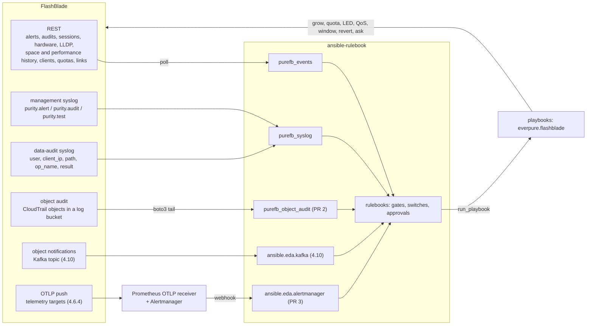

# flashblade-eda

Event-Driven Ansible for Everpure FlashBlade.

A FlashArray tells you what happened to a volume. A FlashBlade tells you
who did it, from where, to which file or object, and can push that itself.
This project turns a FlashBlade's alert log, audit and session logs,
hardware and LLDP view, space and performance history, per-client
performance and quota state into `ansible-rulebook` events and acts on
them through the `everpure.flashblade` collection. No Pure1, no Fusion and
no external monitoring stack are required. It is the sibling of
[flasharray-eda](https://github.com/sdodsley/flasharray-eda) and reuses
its plugin skeleton, rulebook conventions, approval paths and notify
playbook.

Status: a prototype, not a supported product. This first part (the REST
pull plugin, the management syslog listener and ten rulebooks) is written
against Purity//FB 4.6.4 (REST 2.21) on a FlashBlade//S200 and
py-pure-client 1.98.0; [docs/VERIFICATION.md](docs/VERIFICATION.md) lists
the lab exit tests and their state, [docs/DESIGN.md](docs/DESIGN.md) the
design and the parts that come later, and
[docs/HARDWARE_NOTES.md](docs/HARDWARE_NOTES.md) the array and rulebook
behaviour the rules are written around.

The transports the design uses; the first two are in this part, the rest
are the roadmap at the end of this page:



## Quick start

Requirements: Python 3.9+ and Java 17+ (for ansible-rulebook);
ansible-rulebook 1.3.x and ansible-core 2.17 (the tested versions;
`requirements.txt` holds the minimums); `everpure.flashblade` >= 1.29.0 and
`ansible.eda` >= 2.13.0 (`requirements.yml`); py-pure-client >= 1.98.0.
Written against Purity//FB 4.6.4 (REST 2.21); the maintenance-window gate
needs 4.5.2 (REST 2.16) and reads false on anything older.

```
python3 -m venv venv && . venv/bin/activate
make deps                                   # pip install -r requirements.txt; ansible-galaxy collection install -r requirements.yml; make collection
cp env.example ~/.flashblade-eda.env        # URLs and tokens for the arrays, APPROVAL_TOKEN, GIT_WEBHOOK_SECRET; optional AO_CLIENT_*, SLACK_WEBHOOK_URL; chmod 600
cp vars/example.yml vars/local-lab.yml      # edit: arrays, absolute paths (alert_log, request_dir, baseline_dir), baselines, thresholds, switches
cp inventory/example.yml inventory/local-lab.yml
./run.sh extensions/eda/rulebooks/alerts.yml -v
```

The repository is the collection `sdodsley.flashblade_eda` (`galaxy.yml` at
the root): the rulebooks name their event sources by FQCN,
`sdodsley.flashblade_eda.purefb_events` and
`sdodsley.flashblade_eda.purefb_syslog`, and ansible-rulebook resolves them
from an installed collection. `make collection` (which `make deps` runs
last) builds the tarball into `build/` and installs it under
`./collections`; [docs/PACKAGING.md](docs/PACKAGING.md) has the details.

`run.sh` sources `env.sh`, which loads `~/.flashblade-eda.env` (override
with `FBEDA_ENV`), activates `./venv` (`FBEDA_VENV`) or else expects
`ansible-rulebook` on the PATH and says so, puts `./collections` (when that
directory exists) and `~/.ansible/collections` on
`ANSIBLE_COLLECTIONS_PATH`, which is where the FQCN sources resolve from,
and defaults `FBEDA_VARS` to `vars/local-lab.yml` and `FBEDA_INVENTORY` to
`inventory/local-lab.yml`. It then starts the rulebook and hands
`APPROVAL_TOKEN` and `GIT_WEBHOOK_SECRET` to ansible-rulebook with
`--env-vars` when they are set in the environment; that is how the webhook
rulesets read them (`{{ APPROVAL_TOKEN }}` in a rulebook is an environment
variable, not a vars-file key).

Three things to get right on the first run:

- **Arrays.** The example vars and inventory name two arrays, `fb-a` and
  `fb-b`. Either fill in both the `FB_A_*` and `FB_B_*` pairs in the env
  file, or remove `fb-b` from `purefb_arrays` and from the inventory. The
  source plugin refuses to start when a listed array's environment
  variables are empty.
- **Paths.** `alert_log` and `request_dir` default under `/var`
  (`/var/log/flashblade-eda/alerts.log`, `/var/lib/flashblade-eda/requests`),
  which needs root or a directory created and chowned beforehand; for a
  local run point them at a directory the rulebook user can write.
  `baseline_dir` (default `/opt/flashblade-eda-baseline`) is a separate
  checkout of the baseline repository, not this tree.
- **Credentials.** Tokens and URLs reach the plugin through
  `api_token_env` / `fb_url_env` and the playbooks through the inventory's
  `lookup('env', ...)` into `fb_url` and `api_token`, so no vars file holds
  a secret. Give the polling token a `readonly` role; the plugin only
  issues GETs. The remediation playbooks use the inventory credential,
  which should be a dedicated service account named in `automation_users`.

## What it does

| Rulebook | Source | Fires on | Action |
| --- | --- | --- | --- |
| `alerts.yml` | alerts | alert opened, severity raised, closed | routes through the alert-code runbook map (`alert_runbooks`: notify, ticket, or per-code tasks under `playbooks/runbooks/<code>.yml`) with the array's own action text and KB link, then sets the alert's `flagged` bit as the handled marker; already-open alerts arrive as `initial` and are logged |
| `change_control.yml` | audits, webhook | a governed command (`governed_commands`) by anyone but the automation account; a destructive subcommand by a human; a signed git push | NTP and DNS reconciled from the baseline files and the user reported; everything else and every human destroy notified with user, address, interface, command, subcommand and arguments; the automation's own change logged |
| `config_drift.yml` | config | NTP, DNS, directory service, eradication delay and manual eradication, admin lockout and password settings, SSO, Active Directory join, missing data-audit syslog target vs the baseline keys | NTP and DNS reapplied (`purefb_ntp`, `purefb_dns`); the rest notify |
| `health.yml` | health | hardware component whose status is an issue; LAG degraded (status, or `lag_speed` under the sum of its ports); blade or drive issues; component recovered; remote assist, maintenance window | hardware issue outside a window: identify LED (`purefb_hardware`) with the component's LLDP neighbour (switch, port) in the record; inside a window: logged; LAG degraded: critical notify naming the switch ports; blade and drive issues, recovery: notify |
| `capacity.yml` | telemetry, webhook | used % over `capacity_risk_pct`; days-to-full from the array's 7-day space history under `capacity_days_to_full_warning`; a file system at `fs_quota_grow_pct` of a hard quota; an approval (bearer token) | approval request listing pending-eradication file systems, buckets and snapshots and the top growers; reclaim only when approved; `grow_fs.yml` grows a hard-limited file system by `fs_grow_step_pct` up to `fs_grow_max_bytes` behind `fs_auto_grow`, and asks above the cap |
| `quota_user.yml` | alerts (1106, 1107) | a user or group quota alert opened or updated | `user_quota.yml` reads the quota and usage for that file system and user, notifies, and behind `auto_raise_user_quota` raises it by `user_quota_step_pct` up to `user_quota_max_bytes` (`purefb_userquota`, `purefb_groupquota`) |
| `client.yml` | telemetry | array write latency at `baseline_latency_ratio` times the same half hour last week and one NFS or SMB client holding `client_min_share_pct` of ops for `client_consecutive_polls`; a file system holding `qos_cap_min_share_pct` in the same state; a capped file system normal for `qos_lift_normal_polls` | the client's IP mapped to an inventory host and read-only diagnostics run there behind `client_actions_enabled`; a QoS policy `eda-cap-<fs>` created and assigned behind `qos_auto_cap`; the cap lifted |
| `maintenance.yml` | webhook, audits | `{array, action: open, extend or close, hours}` under the bearer token; a window a human opened (`puremaintenance` in the audit stream) | `maintenance_window.yml` posts, re-posts or deletes the array's one window; the human window is logged |
| `sessions.yml` | sessions, alerts (1140, 1123) | a login from outside `admin_cidrs`; repeated failed attempts; the superuser-password-login and default-password alerts | notify |
| `syslog.yml` | purefb_syslog | `purity.alert`, `purity.audit` and `purity.test` lines pushed by the array; data-audit JSON records when a `data-audit` syslog target points here | fast notification seconds after the fact; the REST plugin owns every action |

The gates are what each event allows. `maintenance_active` (one cached
`/maintenance-windows` read per array; false where the endpoint is absent)
travels on alert, audit, session, health, hardware and config events and
holds back the alert runbooks, the reconcile and the identify LED; the
telemetry events carry no flag, so the file system grow, the client
diagnostics and the QoS cap run inside a window too, and the array itself
keeps routing the codes it exempts from a window (1101, 1106, 1107 among
them), so the quota rules fire inside one. `automation_users` (plus the
`pure/py-pure-client` user agent, reported as `automation_agent`) keeps
the audit-driven rules from reacting to the automation's own changes. Four
per-site switches fall back to notify: `fs_auto_grow`,
`auto_raise_user_quota`, `client_actions_enabled` and `qos_auto_cap`; the
reapply, the reconcile and the identify LED have none, and
`orchestrator_enabled` moves the capacity decision into the automation
orchestrator. Every record a playbook writes to the alert log carries
`time`, `kind`, `severity` and `array`, and every notification also
reaches Slack when a webhook is configured ("Notifications" below).

## Layout

```
galaxy.yml, meta/runtime.yml           the repository root is the collection sdodsley.flashblade_eda (docs/PACKAGING.md)
extensions/eda/plugins/event_source/   purefb_events.py (REST pull, six signals), purefb_syslog.py (push)
extensions/eda/rulebooks/              one rulebook per domain (table above), sources named by FQCN
playbooks/                             notify, alert_runbook (+ runbooks/<code>.yml), flag_alert, identify_led, reconcile,
                                       remediate_ntp, remediate_dns, capacity_request/reclaim, orchestrator_post, grow_fs,
                                       user_quota, client_diagnose, qos_cap, qos_lift, maintenance_window,
                                       tasks/resolve_array.yml (the array's URL and token), tasks/fb_rest.yml (one raw
                                       REST call for the endpoints the collection has no module for)
vars/example.yml, inventory/example.yml  copy to vars/local-<site>.yml and inventory/local-<site>.yml (gitignored)
env.example, env.sh, run.sh            env file template, shared environment setup, launcher
tests/                                 unit/ (no array needed), fixtures, replay rulebooks, e2e_sources.sh (everything
                                       it writes goes under tests/out/)
docs/                                  DESIGN.md (design and scope), VERIFICATION.md (the lab exit tests), HARDWARE_NOTES.md
                                       (array and rulebook behaviour), PACKAGING.md (the collection and its build)
Makefile                               `make check` runs what CI runs; `make collection` builds and installs the collection
requirements.txt, requirements.yml     Python packages and the two collections (everpure.flashblade >= 1.29.0)
```

## The source plugins

`purefb_events` polls one or more arrays with py-pure-client and emits plain
fact events; policy lives in the rulebooks. `arrays` is a list, or a JSON
string that decodes to one so a platform credential can inject it as a
single variable. One instance can run several signals, each on its own
interval; every REST call is bounded by `request_timeout` (default 30 s).
The client is built for the REST version the array serves (2.21 on 4.6.4)
and the code calls nothing that version lacks:

| Signal | Endpoints | Events |
| --- | --- | --- |
| alerts | `/alerts` (state != closed, with an unfiltered fallback), diffed locally; FlashBlade has no `/alerts/events` and its alerts are open or closed, nothing else | `purefb_alert` with transition initial / opened / updated / closed, code, severity, component, summary, action, KB link, `flagged`, `variables`, `age_s`, `resolved_after_s`, `severity_raised` |
| audits | `/audits` newest N, cut at a local time cursor | `purefb_audit` with user, `user_agent`, `ip_address`, `user_interface`, command, subcommand, arguments, `by_automation`, `automation_agent`, `destructive` |
| sessions | `/sessions`, cursor on `start_time` | `purefb_session` with event, `event_count`, user, location, method, interface |
| health | `/hardware`, `/blades`, `/drives`, `/link-aggregation-groups`, `/hardware-connectors`, `/network-interfaces/neighbors` (LLDP, cached), `/maintenance-windows`, `/support`, `/arrays` | `purefb_health` (issue lists and counts, LAGs, blade and drive counts, window list, remote assist, open alerts), `purefb_hardware` per issue with its LLDP neighbour, `purefb_hardware_recovered`, `purefb_lag` on degradation and recovery with the member ports and their switch ports |
| telemetry | `/arrays/space` (+ 7-day history, by type), `/file-systems` and `/buckets` space (growth tracked across polls), `/arrays/performance` (+ same half hour last week), `/arrays/nfs-specific-performance`, `/arrays/clients/performance`, `/file-systems/performance` and `/buckets/performance` top N (plus anything whose QoS policy starts with `eda-cap-`), destroyed objects | `purefb_capacity` (days_to_full, file system and object store growth, pending eradication counts, top growers, drr_drop, snapshot_surge), `purefb_fs_quota` per file system at `fs_quota_warn_pct` of a hard quota, `purefb_array_performance` (baseline ratios, write_surge), `purefb_client_performance` (ops share and streaks per client IP), `purefb_fs_performance` and `purefb_bucket_performance` (ops share, `eda_capped`) |
| config | `/arrays`, `/dns`, `/directory-services`, `/active-directory`, `/admins/settings`, `/sso/saml2/idps`, `/syslog-servers`, `/smtp-servers`, `/alert-watchers`, `/support` | `purefb_config` (csv fields for the list values, `syslog_data_audit_servers_csv`, `ad_joined`, eradication and admin settings) |

Every event carries `array`; alert, audit, session, health, hardware and
config events also carry `maintenance_active`; poll failures arrive as
`purefb_poll_error` with a consecutive count and an `escalate` flag at
`poll_error_escalate`, and polling continues. The `replication` and
`posture` signals of the design are not in this part and are refused by
name. Full argument and field lists are in the plugin docstring.

`purefb_syslog` listens on UDP and TCP for what the array's syslog servers
send and emits one event per line, named by kind: `purefb_syslog_alert`,
`purefb_syslog_audit`, `purefb_syslog_test`, `purefb_syslog_other`,
`purefb_file_event` and, from the sliding windows over the file events,
`purefb_file_activity`. A FlashBlade syslog server carries
`services`: with `management` the line is one of the Purity layouts, and
the listener parses `purity.alert` (`<SEVERITY> <State> - <array>:
<subject> [<code>]` plus the `Severity:`, `State:`, `Array Name:` and
`Knowledge Base Article:` fields in the detail) and `purity.audit`
(`Adding audit entry. GUID=..., ID=..., Time=..., User=..., Location=...,
UI=CLI|GUI|REST, Command=..., Subcommand=..., Arguments=...`) into fields;
with `data-audit` each line is one JSON object (`pf: fb`, `user`,
`client_ip`, `proto`, `fs`, `path`, `op_name`, `result`, up to 128 KB per
line) and the listener emits it as `purefb_file_event`, tallying deletes,
create+delete pairs and extension-changing renames per file system, user
and client into `purefb_file_activity` once a window crosses a threshold;
the same JSON with `pf: fa` is what a FlashArray sends, so one parser
serves both. `allowed_sources` restricts the senders it accepts (empty =
any) and `hostnames` maps an array's own name or its syslog hostname to
the inventory name. On the array, `everpure.flashblade.purefb_syslog` creates the server
with `tcp://<eda host>:5140` and the services it should carry.

## State without tags

FlashBlade has no tags on file systems or buckets, so nothing from the
FlashArray project's `eda` tag namespace carries over. State that must
survive a rulebook restart lives on the array as a name or a bit, or in a
file: the QoS cap is a policy named `eda-cap-<file system>` (the telemetry
signal reads it back as `eda_capped`; a second policy `eda-tarpit` is
reserved for the containment work of a later part); a handled alert has
its `flagged` bit set; a quarantined client, later, is an export rule
`client == <ip>, permission ro`; the approval request is a file under
`request_dir`; the maintenance window is itself the state. The two `eda`
buckets of the design (one versioned for cursors and receipts, one
Object-Locked for the log and approvals) are the second part.

## Notifications

Every rule that notifies runs `playbooks/notify.yml` (the alert runbook
map is the exception: `alert_runbook.yml` writes its own ticket or notify
record and posts nothing), which appends a record to the alert log and,
when `SLACK_WEBHOOK_URL` is set in the env file, posts the same record to a
Slack incoming webhook: an icon for the severity, the severity, the
subject with the array named once, and the detail on the next line,
escaped for Slack. A failed post is reported in the job and never fails
the notification; the alert log is the record, Slack is the pager. Only
records at or above `slack_min_severity` are posted (an extra var, else
`SLACK_MIN_SEVERITY` in the environment, else warning).

Two rulesets listen on the network, bound and authenticated differently
(see also [SECURITY.md](SECURITY.md)):

- **Approvals and maintenance windows** (`approval_port`, default 5001;
  `maintenance_port`, default 5003): the POST must carry
  `Authorization: Bearer $APPROVAL_TOKEN`.

      curl -s -X POST http://<eda host>:5001/endpoint \
        -H "Authorization: Bearer $APPROVAL_TOKEN" -H 'Content-Type: application/json' \
        -d '{"request_id": "<id>", "approve": true, "approver": "jane", "action": "eradicate_pending"}'
      curl -s -X POST http://<eda host>:5003/endpoint \
        -H "Authorization: Bearer $APPROVAL_TOKEN" -H 'Content-Type: application/json' \
        -d '{"array": "fb-a", "action": "open", "hours": 2}'

- **Git push** (`webhook_port`, default 5000): the POST must carry GitHub's
  `X-Hub-Signature-256: sha256=<hex HMAC-SHA256 of the exact body>` made
  with `GIT_WEBHOOK_SECRET`; GitHub adds it when the webhook has a secret.
- **Syslog** (`syslog_host`, `syslog_port`, default 5140):
  `syslog_allowed_sources` lists the addresses or CIDR prefixes the listener
  accepts (empty = any). It is a filter, not authentication, which is one
  reason `syslog.yml` only notifies.

## Tests

`make check` needs no array: black, pyflakes and yamllint over the plugins
and the tests; the unit tests (`python -m pytest tests/unit`: a fake SDK
client drives the alert diff and transitions, the audit and session
cursors, the health issue sets and LAG degradation with the LLDP cache,
days-to-full from seven points, the quota threshold, the client share
streaks, the config csv fields and the poll-error streaks; static checks
validate every rulebook against ansible-rulebook's own schema, require
every lowercase variable a rulebook references to be documented in
`vars/example.yml` and every playbook a rule runs to exist, and check the
notify playbook and the `set_stats` artifacts); and a playbook syntax
check. GitHub Actions runs the same on every push.

`tests/replay_*.yml` are copies of the live rules driven by
`ansible.eda.generic` from the fixtures under `tests/fixtures/` (alerts, a
blade and a LAG fault, days to full, a client's share); ansible-rulebook
has no include, so they must stay rule-for-rule identical to the real
rulebooks, throttles included, and the unit test fails when they drift.

`tests/e2e_sources.sh` runs the rulebooks against a live array with
`--print-events` for a fixed time each and counts the event names, opens
and closes a one-hour maintenance window to see `maintenance_active` flip,
replays the hardware fixture to light and clear an identify LED, and runs
the audits signal directly. It sources `env.sh`; reads the array
credentials from the environment variables named by `A_URL_ENV` /
`A_TOKEN_ENV` (default `FB_A_URL` / `FB_A_TOKEN`); derives its own vars
file into `tests/out/vars_test.yml` from `FBEDA_VARS` with `alert_log` and
`request_dir` rewritten under `tests/out/`; and never creates, destroys or
resizes anything. The quota, grow and client exit tests need a scratch
file system and a load generator and are listed, with their state, in
[docs/VERIFICATION.md](docs/VERIFICATION.md).

## Roadmap

Three parts on the 4.6.4 lab, then what newer Purity//FB releases unlock.
The reasoning is in [docs/DESIGN.md](docs/DESIGN.md).

- **PR 2, the object side.** `purefb_object_audit`: a boto3 source that
  tails the CloudTrail-style log objects an object-audit policy writes
  into a log bucket on the array and emits one `purefb_s3_event` per
  record. The two `eda` buckets (state, and an Object-Locked log and
  approval inbox). Rulebooks: `canary.yml` (a GET on a canary prefix by a
  key not on the allow-list disables that key), `landing.yml` (a
  `_SUCCESS` or manifest object starts the ingest job), the auditor guard
  (an audit policy detached, a log bucket near its quota, no log object
  for two rotations, alert 1139), `posture.yml` (world-open export rules,
  everyone-full-control shares, public buckets, old keys, expiring
  certificates). Needs three modules on the collection first: object
  audit policies, log targets and bucket audit filters.
- **PR 3, telemetry and the data path.** Modules for telemetry targets and
  metric policies, maintenance windows, QoS policies and SMB session and
  lock termination; OTLP push into a Prometheus OTLP receiver with
  `flashblade.rules.yml` generated from the array's own policy listing and
  the Alertmanager rulebook; `contain.yml` (an ordered export rule that
  downgrades one client to read-only, a tarpit QoS policy), `locks.yml`
  (a dead client's locks and sessions, behind approval), `replication.yml`
  (file system and bucket replica links, connections and paths), a DR
  drill that promotes and demotes a replica on the peer, and a daily
  showback ledger written to the array.
- **Purity//FB 4.8.0:** NFS file-access audit, which makes honeyfiles, an
  inbox folder and per-user access storms observable over the data-audit
  syslog. **4.8.6:** per-rule telemetry resolution, so collections can be
  raised during an incident. **4.10:** object notifications to Kafka;
  `ansible.eda.kafka` takes the bucket tail's place behind the same event
  filter, and the canary latency drops from one log rotation to seconds.

## Related

- Blog post: "Your FlashBlade already knows who did it" (to follow; the
  FlashArray post is
  https://theansibleguy.com/your-flasharray-is-already-an-event-source/).
- Sibling: https://github.com/sdodsley/flasharray-eda
- Collection: https://github.com/Everpure-Ansible/FlashBlade-Collection
  (module bugs go there, not here)
- Rulebook docs: https://docs.ansible.com/projects/rulebook/en/latest/

## Licence

Apache 2.0, see [LICENSE](LICENSE).
